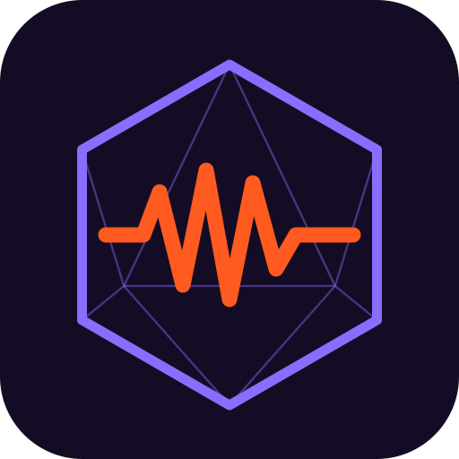

<p align="center"></p>

# DynamicMusic

Reproductor de música y ambientación para sesiones de rol de mesa. Cada **escena** tiene cuatro moods (PAUSED, NORMAL, RAGED, ADVANTAGE) con su track, un fondo de imagen o video y un **aura** visual que reacciona a la música. Durante la partida cambiás de mood con el teclado y todo acompaña el momento.

Proyecto personal, sin fines comerciales.


## Qué hace

- **Escenas** con un track por mood, fondo (imagen o video) y un aura por mood.
- **Aura reactiva** que sigue el bombo, el redoblante y la melodía, sin tapar el centro de la pantalla.
- **Ventana de ambiance** para mostrar en otro monitor.
- **Play now y playlists** para tocar cualquier track fuera de los moods.
- **YouTube**: buscar y bajar audio desde la app.

## Instalar

Bajá `DynamicMusic-Setup-X.Y.Z.exe` desde [Releases](https://github.com/MarianoCarrizo/DynamicMusic/releases) y seguí el instalador. Trae todo lo necesario (Java y ffmpeg), no pide administrador y se actualiza solo: cuando hay una versión nueva aparece un aviso para instalarla ahora o al cerrar.

Opcional: **Node.js** o **Deno** mejoran la descarga desde YouTube.

## Cómo se usa

| Acción | Cómo |
|---|---|
| Cargar música | **Open Folder** |
| Asignar un track a un mood | Arrastrarlo a la tarjeta, o clic derecho → **Assign to** |
| Cambiar de mood | Teclas **1 / 2 / 3 / 4** o clic en la tarjeta |
| Escuchar sin asignar | Doble clic en la biblioteca |
| Reproducir on demand | Clic derecho → **Play now**, o **Enter** |
| YouTube | Pegar una URL y **Add** o **Play**; **Browse** para buscar |
| Escenas | **+** para crear, **Save as** para duplicar, **Edit scene** para auras y fondo |
| Sacar el fondo | **Edit scene** → **Background** → **Remove** |
| Ajustar el aura en vivo | Franja **Live aura** |
| Ventana de ambiance | **Show/Hide ambiance**; la flecha elige el monitor |

## Formatos de audio

**Soportados:** MP3, WAV y FLAC. **No soportados:** OGG, Opus, M4A/AAC, WMA, AIFF y otros (no aparecen en la biblioteca). Lo que se baja de YouTube se guarda como MP3.

Tus escenas y descargas se guardan en `%APPDATA%\DynamicMusic` y no se borran al actualizar ni desinstalar.

## Correr desde el código

Con JDK 21 y ffmpeg en el PATH:

```bash
./mvnw javafx:run
```

## Aviso sobre YouTube

La descarga de audio de YouTube es para uso personal. Respetar los derechos de autor y los términos de servicio de YouTube es responsabilidad de quien usa la app.

## Apoyar el proyecto

DynamicMusic es gratis y open source. Si te sirve en tus partidas, podés invitarme un cafecito:

[](https://cafecito.app/duhonha)

## Licencia

[Apache 2.0](LICENSE)
