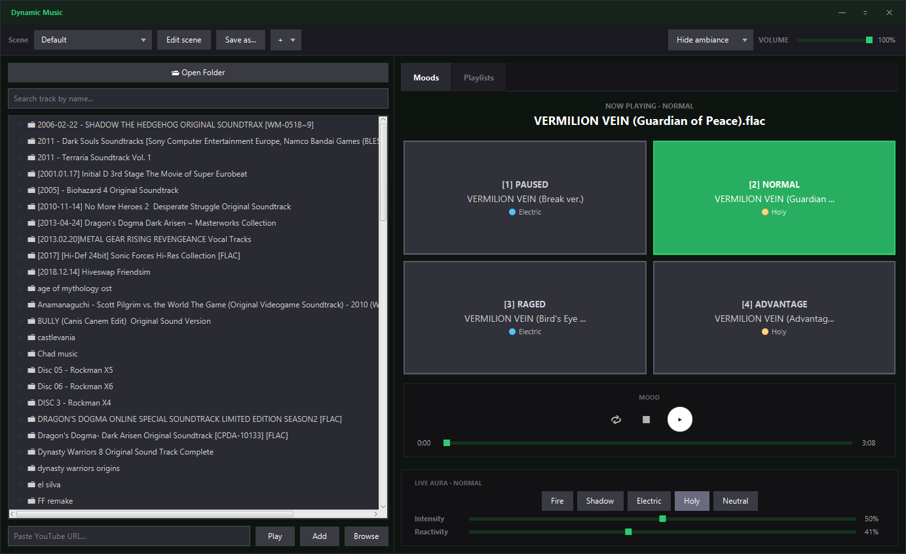
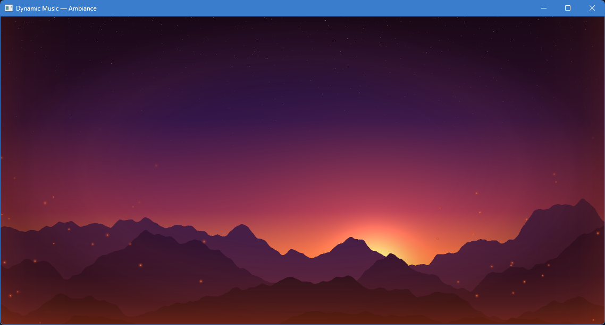

# DynamicMusic

Reproductor de música y ambientación para sesiones de rol de mesa. Cada **escena** agrupa cuatro moods (PAUSED, NORMAL, RAGED, ADVANTAGE) con su track, un fondo de imagen o video y un **aura** visual que reacciona a la música. Durante la partida se cambia de mood con el teclado y la música y el aura acompañan el momento.

Proyecto personal, sin fines comerciales.





## Funcionalidades

- **Escenas**: tracks de los cuatro moods, fondo (imagen o video con recorte A-B, velocidad y boomerang) y cinco auras: una por mood y una para la música on demand. Se guardan solas y se pueden duplicar con **Save as**.
- **Aura reactiva**: viñeta, brillo de borde, brasas y un pulso sutil del fondo. El centro de la pantalla queda limpio. El análisis separa la percusión del resto: el bombo marca el pulso, el redoblante los destellos y la parte tonal la respiración. PAUSED siempre se muestra calmo.
- **Live aura**: ajuste en vivo del preset, la intensidad y la reactividad del aura que está en pantalla.
- **Ventana de ambiance**: se muestra u oculta cuando se quiera y se puede enviar a otro monitor.
- **Play now (on demand)**: reproduce cualquier track de la biblioteca o de YouTube en el panel izquierdo, reemplazando al mood hasta que se elija uno.
- **Playlists**: reproducción en lista con shuffle y loop. Usan el aura on demand de la escena.
- **YouTube**: búsqueda dentro de la app y descarga del audio con una copia propia de yt-dlp que se actualiza sola.

## Requisitos

- **JDK 21+**
- **ffmpeg**: lo usan la descarga de audio de YouTube y el boomerang de video. El instalador de Windows ya lo incluye; al correr desde el código fuente tiene que estar en el PATH.
- Opcional: **Node.js** o **Deno**. yt-dlp los usa para extraer de YouTube de forma confiable.

En Windows, yt-dlp no hace falta instalarlo: la app descarga su propia copia en la primera ejecución. En Linux y macOS hay que tener `yt-dlp` en el PATH.

## Correr la app

```bash
# Linux, macOS o Git Bash
./mvnw javafx:run
```

```powershell
# Windows (PowerShell o cmd)
.\mvnw.cmd javafx:run
```

### Modo debug

Habilita el HUD de diagnóstico del aura (tecla **F3** en la ventana de ambiance) y graba los valores del análisis de audio en `audio-debug.csv`:

```bash
./mvnw javafx:run -Pdebug
```

## Uso

| Acción | Cómo |
|---|---|
| Cargar la biblioteca | **Open Folder** |
| Asignar un track a un mood | Arrastrar el track a la tarjeta del mood, o clic derecho → **Assign to** |
| Cambiar de mood | Tarjetas `[1]`-`[4]` o teclas **1 / 2 / 3 / 4** |
| Escuchar un track antes de asignarlo | Doble clic en la biblioteca |
| Reproducir on demand | Clic derecho → **Play now**, o **Enter** sobre el track |
| YouTube | Pegar una URL y **Add** (a la playlist) o **Play** (on demand); **Browse** para buscar |
| Escenas | Selector arriba; **+** para crear, **Save as** para duplicar, **Edit scene** para configurar auras y fondo |
| Ajustar el aura en vivo | Franja **Live aura**, debajo de las pestañas |
| Ventana de ambiance | **Show/Hide ambiance**; la flecha del botón elige el monitor |

## Datos locales

Todo se guarda en `%APPDATA%\DynamicMusic` (en Linux y macOS, `~/DynamicMusic`):

| Ruta | Contenido |
|---|---|
| `session.json` | Escenas, playlists y preferencias. Al migrar una sesión antigua se guarda una copia en `session.json.bak` |
| `library/` | Copias permanentes de los tracks de YouTube usados en escenas |
| `yt-cache/` | Caché de descargas de YouTube (se limpia sola) |
| `bin/` | Copia de yt-dlp administrada por la app |
| `updates/` | Instalador de una versión nueva ya descargada y verificada |

## Instalador para Windows

Las versiones se publican en [Releases](https://github.com/MarianoCarrizo/DynamicMusic/releases) como `DynamicMusic-Setup-X.Y.Z.exe` junto con su `.sha256`. Es un instalador clásico (Siguiente, Siguiente, Instalar) hecho con Inno Setup. Incluye el runtime de Java y ffmpeg, así que no hay que instalar nada más.

- Instala por usuario en `%LOCALAPPDATA%\Programs\DynamicMusic` (no pide administrador, así las actualizaciones silenciosas siempre encuentran la instalación anterior).
- Crea accesos directos en el escritorio y en el menú Inicio, y un desinstalador.
- Instalar una versión más nueva actualiza en el lugar.
- Los datos de `%APPDATA%\DynamicMusic` no se tocan al instalar ni al desinstalar.
- ffmpeg se instala en la carpeta `ffmpeg` junto a la app. La app usa esa copia y, si no existe, el ffmpeg del PATH. La compilación incluida es GPL (BtbN FFmpeg-Builds) y trae su `LICENSE.txt`.

### Actualización automática

Solo en la app instalada (al correr con `mvnw` está desactivada):

1. Al iniciar, y como máximo una vez cada 24 horas, consulta el último release publicado en GitHub. Ignora borradores y prereleases.
2. Si hay una versión más nueva, descarga el instalador en segundo plano a `%APPDATA%\DynamicMusic\updates` y verifica su SHA-256 con el `.sha256` del release. Si no coincide, lo borra.
3. Cuando está listo aparece un aviso arriba en la ventana: **Version X.Y.Z is ready**. La reproducción nunca se interrumpe sola.
   - **Install now**: guarda la sesión, cierra la app, instala en silencio y la vuelve a abrir.
   - **On close**: instala al cerrar la app. Si no se elige ninguna, el aviso vuelve a aparecer en el próximo inicio.

Sin conexión o con el límite de la API de GitHub excedido, la comprobación falla en silencio y se reintenta más adelante.

### Publicar una versión

Crear y subir un tag `vX.Y.Z` desde la rama que se quiere publicar (normalmente `Master`):

```bash
git tag v1.2.3
git push origin v1.2.3
```

El workflow `.github/workflows/release.yml` corre los tests, arma la app con `jpackage`, descarga ffmpeg y los jmods de JavaFX con checksum verificado, compila el instalador con Inno Setup y publica el release con el `.exe` y su `.sha256`. La versión sale del tag y llega a la app como `-Ddynamicmusic.version`. Los pull requests y las ejecuciones manuales solo compilan y dejan el instalador como artefacto del workflow.

Para actualizar ffmpeg o JavaFX hay que cambiar la URL y el SHA-256 en el bloque `env` del workflow.

Para probar el script del instalador a mano hace falta Inno Setup 6.3 o superior: `ISCC installer\DynamicMusic.iss /DMyAppVersion=1.2.3 /DAppImageDir=<app-image> /DFfmpegDir=<ffmpeg>`.

### MSI local (legado)

`.\mvnw.cmd package -DskipTests` sigue generando un MSI con `jpackage-maven-plugin` si están WiX Toolset 3.x y los jmods de JavaFX 21 en `C:/javafx-jmods-21.0.13`. Este MSI no incluye ffmpeg ni la actualización automática. Para omitirlo, agregar `-DskipInstaller=true`.

## Aviso sobre YouTube

La descarga de audio de YouTube es para uso personal. Respetar los derechos de autor y los términos de servicio de YouTube es responsabilidad de quien usa la app.

## Licencia

[Apache 2.0](LICENSE)
